# Schemat bazy danych

Plik generują reguły projektu (panel Maven → Lifecycle → verify). Nie edytujcie go ręcznie.

Tabele: 6 · kolumny: 36 · relacje: 4 × @ManyToOne, 1 × @OneToMany, 1 × @OneToOne, 0 × @ManyToMany

| Tabela | Encja | Kolumny | Klucze obce |
|---|---|---|---|
| character_item | CharacterItem | 5 | character_id, item_id |
| game_character | GameCharacter | 10 | game_system_id, user_account_id |
| game_item | Item | 5 | — |
| game_system | GameSystem | 5 | — |
| skill | Skill | 6 | game_system_id |
| user_account | UserAccount | 5 | — |

```mermaid
erDiagram
    character_item {
        Long id PK
        Long character_id FK
        Boolean is_equipped
        Long item_id FK
        Integer quantity
    }
    game_character {
        Long character_id PK
        Integer character_level
        LocalDate created_date
        Integer current_hit_points
        Integer experience_points
        Long game_system_id FK
        Integer max_hit_points
        String name
        CharacterStatus status
        Long user_account_id FK
    }
    game_item {
        Long item_id PK
        BigDecimal cost
        Boolean is_magical
        String item_name
        BigDecimal weight
    }
    game_system {
        Long system_id PK
        String edition
        Boolean is_active
        String name
        String publisher
    }
    skill {
        Long skill_id PK
        Integer base_value
        String description
        Long game_system_id FK
        Boolean is_magical
        String skill_name
    }
    user_account {
        Long id PK
        LocalDateTime created_at
        String display_name
        String email
        AccountRole role
    }
    game_character ||--o{ character_item : "character_id"
    game_item ||--o{ character_item : "item_id"
    game_system ||--o{ game_character : "game_system_id"
    game_system ||--o{ skill : "game_system_id"
    user_account |o--o| game_character : "user_account_id"
```

